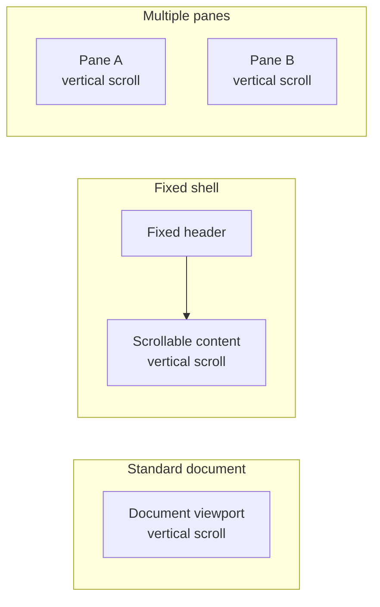
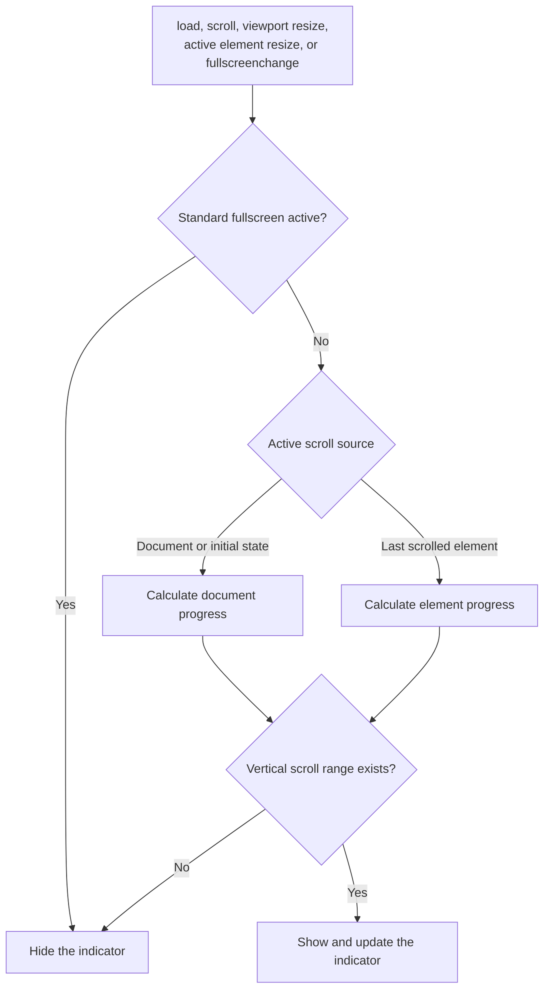

# Scroll Progress

A small Chrome extension that shows the vertical scroll progress of the area you are reading.

The progress is displayed at the bottom left. Click the extension icon to hide or show it for the current tab.

## Supported Layouts

| Layout | Behavior |
|---|---|
| Standard document | Shows the progress of the document viewport. |
| Fixed shell with a scrollable body or panel | Follows the element after it starts scrolling. |
| Multiple scrollable panes | Follows the pane that was scrolled most recently. |
| Viewport resize | Recalculates the current scroll area. |
| Active pane resize | Recalculates the active element without polling the page. |
| Standard Fullscreen API | Hides during fullscreen and restores after fullscreen ends. |

The extension starts with the document viewport. A scroll event from an element with a vertical scroll range makes that element the active scroll area. In a multi-pane layout, the latest vertically scrolled pane wins. Horizontal-only scroll areas do not replace the current source.

## Limits

- Horizontal scroll progress is not supported.
- Scroll areas inside iframes are not observed. The content script runs in the top frame only.
- Scroll areas inside shadow roots are not observed.
- Site-specific CSS pseudo-fullscreen modes are not detected.
- Browser fullscreen started with F11 is not treated as content fullscreen.
- Only one indicator is shown. It follows the most recently scrolled area.

The behavior is based on the [CSSOM View Module](https://www.w3.org/TR/cssom-view/), [DOM Standard](https://dom.spec.whatwg.org/), [Resize Observer](https://www.w3.org/TR/resize-observer/), [Fullscreen Standard](https://fullscreen.spec.whatwg.org/), and the [Chrome content scripts manifest](https://developer.chrome.com/docs/extensions/reference/manifest/content-scripts).

## Screenshot

## Install

[Chrome Web Store](https://chromewebstore.google.com/detail/scroll-progress/lcmhhnccfbeinmgacmomlkcahidhjifb)

## Privacy

[Privacy Policy](./PRIVACY.md)

## Thanks

- https://github.com/adamzap/scroll-progress
- https://github.com/qiao/scroll-progress

## License

[MIT License](http://www.opensource.org/licenses/mit-license.php)

&copy; 2017 [harapeko](https://twitter.com/harapeko_wktk)

Permission is hereby granted, free of charge, to any person obtaining a copy of this software and associated documentation files (the "Software"), to deal in the Software without restriction, including without limitation the rights to use, copy, modify, merge, publish, distribute, sublicense, and/or sell copies of the Software, and to permit persons to whom the Software is furnished to do so, subject to the following conditions:

The above copyright notice and this permission notice shall be included in all copies or substantial portions of the Software.

THE SOFTWARE IS PROVIDED "AS IS", WITHOUT WARRANTY OF ANY KIND, EXPRESS OR IMPLIED, INCLUDING BUT NOT LIMITED TO THE WARRANTIES OF MERCHANTABILITY, FITNESS FOR A PARTICULAR PURPOSE AND NONINFRINGEMENT. IN NO EVENT SHALL THE AUTHORS OR COPYRIGHT HOLDERS BE LIABLE FOR ANY CLAIM, DAMAGES OR OTHER LIABILITY, WHETHER IN AN ACTION OF CONTRACT, TORT OR OTHERWISE, ARISING FROM, OUT OF OR IN CONNECTION WITH THE SOFTWARE OR THE USE OR OTHER DEALINGS IN THE SOFTWARE.
